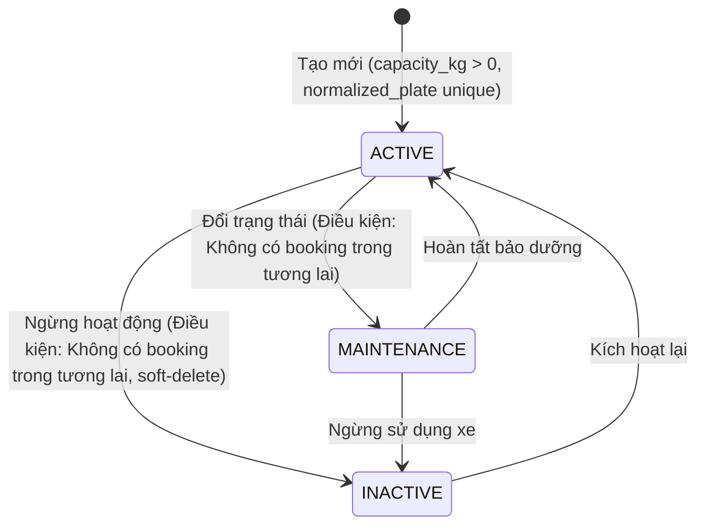
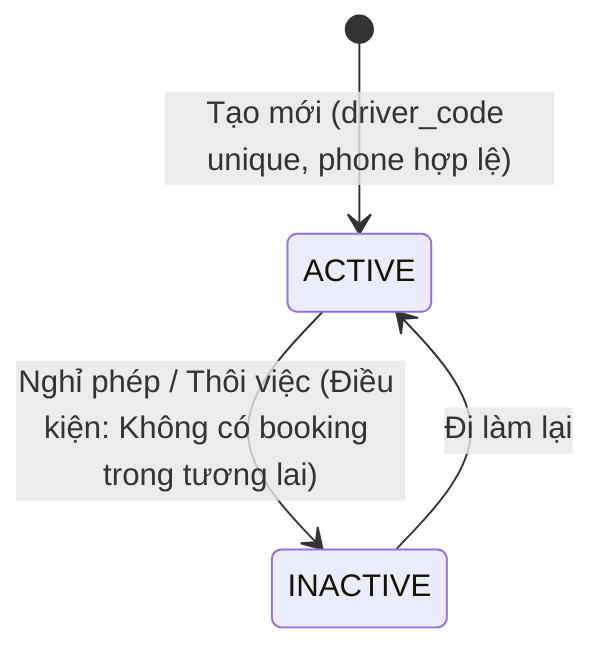

# Data Model Specification: TRN-01 Quản lý xe và tài xế

**Feature**: `001-truck-and-driver-management`  
**Date**: 2026-11-23  
**Status**: Draft  

---

## 1. Thực thể (Entities) & Thuộc tính

### 1.1. Bảng `trucks` (Danh mục Phương tiện Vận tải)

Lưu trữ thông tin phương tiện vận chuyển, biển số, loại xe, tải trọng cho phép và trạng thái hoạt động.

| Tên trường | Kiểu dữ liệu | Ràng buộc | Mô tả |
| :--- | :--- | :--- | :--- |
| `id` | `INTEGER` | `PRIMARY KEY, AUTOINCREMENT` | Khóa chính định danh xe |
| `plate_number` | `VARCHAR(20)` | `NOT NULL` | Biển số xe hiển thị gốc (ví dụ: `29C-123.45`) |
| `normalized_plate`| `VARCHAR(20)` | `NOT NULL, UNIQUE, INDEX` | Biển số chuẩn hóa (in hoa, bỏ dấu, khoảng trắng: `29C12345`) |
| `truck_type` | `VARCHAR(50)` | `NOT NULL` | Loại thùng/phương tiện (Xe thùng kín, Xe bạt, Xe lạnh...) |
| `capacity_kg` | `INTEGER` | `NOT NULL, CHECK (capacity_kg > 0)` | Tải trọng tối đa cho phép tính bằng kg |
| `description` | `VARCHAR(255)` | `NULLABLE` | Ghi chú hoặc thông tin bổ sung |
| `status` | `VARCHAR(20)` | `NOT NULL, DEFAULT 'ACTIVE'` | Trạng thái xe: `ACTIVE`, `MAINTENANCE`, `INACTIVE` |
| `created_at` | `DATETIME` | `NOT NULL, DEFAULT CURRENT_TIMESTAMP` | Thời điểm tạo bản ghi |
| `updated_at` | `DATETIME` | `NOT NULL, DEFAULT CURRENT_TIMESTAMP` | Thời điểm cập nhật cuối cùng |

---

### 1.2. Bảng `drivers` (Danh mục Tài xế)

Lưu trữ danh sách tài xế, mã định danh duy nhất, thông tin liên lạc và trạng thái lao động.

| Tên trường | Kiểu dữ liệu | Ràng buộc | Mô tả |
| :--- | :--- | :--- | :--- |
| `id` | `INTEGER` | `PRIMARY KEY, AUTOINCREMENT` | Khóa chính định danh tài xế |
| `driver_code` | `VARCHAR(20)` | `NOT NULL, UNIQUE, INDEX` | Mã tài xế duy nhất (ví dụ: `TX001`) |
| `full_name` | `VARCHAR(100)` | `NOT NULL` | Họ và tên đầy đủ |
| `phone_number` | `VARCHAR(20)` | `NOT NULL` | Số điện thoại liên hệ (10 chữ số) |
| `status` | `VARCHAR(20)` | `NOT NULL, DEFAULT 'ACTIVE'` | Trạng thái: `ACTIVE`, `INACTIVE` |
| `created_at` | `DATETIME` | `NOT NULL, DEFAULT CURRENT_TIMESTAMP` | Thời điểm tạo bản ghi |
| `updated_at` | `DATETIME` | `NOT NULL, DEFAULT CURRENT_TIMESTAMP` | Thời điểm cập nhật cuối cùng |

---

### 1.3. Bảng `resource_bookings` (Lịch Trình Chiếm Dụng Nguồn Lực - Nền tảng cho TRN-01 & TRN-02)

Lưu vết các khoảng thời gian xe hoặc tài xế được phân công phục vụ đơn vận tải hoặc chuyến hàng, dùng để tính toán lịch rảnh/bận tự động và ngăn chặn xóa cứng dữ liệu lịch sử.

| Tên trường | Kiểu dữ liệu | Ràng buộc | Mô tả |
| :--- | :--- | :--- | :--- |
| `id` | `INTEGER` | `PRIMARY KEY, AUTOINCREMENT` | Khóa chính bản ghi booking |
| `resource_type` | `VARCHAR(20)` | `NOT NULL` | Loại nguồn lực: `TRUCK` hoặc `DRIVER` |
| `resource_id` | `INTEGER` | `NOT NULL, INDEX` | Khóa ngoại mềm tới `trucks.id` hoặc `drivers.id` |
| `reference_code`| `VARCHAR(50)` | `NOT NULL` | Mã chuyến hàng hoặc mã đơn vận tải liên kết |
| `start_time` | `DATETIME` | `NOT NULL` | Thời điểm bắt đầu chiếm dụng |
| `end_time` | `DATETIME` | `NOT NULL` | Thời điểm kết thúc chiếm dụng |
| `status` | `VARCHAR(20)` | `NOT NULL, DEFAULT 'CONFIRMED'` | `CONFIRMED`, `IN_PROGRESS`, `COMPLETED`, `CANCELLED` |
| `created_at` | `DATETIME` | `NOT NULL, DEFAULT CURRENT_TIMESTAMP` | Thời điểm tạo bản ghi |
| `updated_at` | `DATETIME` | `NOT NULL, DEFAULT CURRENT_TIMESTAMP` | Thời điểm cập nhật |

---

## 2. State Machine & Quy tắc chuyển trạng thái

### 2.1. Vòng đời Xe (`TruckStatus`)

- **Quy tắc bảo vệ**:
  1. Không cho phép chuyển từ `ACTIVE` sang `MAINTENANCE` hoặc `INACTIVE` nếu tồn tại `resource_bookings` có `end_time >= CURRENT_TIMESTAMP` và `status IN ('CONFIRMED', 'IN_PROGRESS')`.
  2. Tuyệt đối không cho phép chuyển sang `INACTIVE` khi xe đang thực hiện chuyến đi (`IN_PROGRESS`).

---

### 2.2. Vòng đời Tài xế (`DriverStatus`)

- **Quy tắc bảo vệ**:
  1. Không cho phép chuyển sang `INACTIVE` nếu tài xế có lịch chạy trong tương lai chưa được gỡ hoặc phân công lại.

---

## 3. Ràng buộc toàn vẹn & Chỉ mục (Indices & Constraints)

1. **Unique Indices**:
   - `ix_trucks_normalized_plate`: `UNIQUE (normalized_plate)`
   - `ix_drivers_driver_code`: `UNIQUE (driver_code)`
2. **Check Constraints**:
   - `ck_truck_capacity_positive`: `CHECK (capacity_kg > 0)`
   - `ck_truck_status_valid`: `CHECK (status IN ('ACTIVE', 'MAINTENANCE', 'INACTIVE'))`
   - `ck_driver_status_valid`: `CHECK (status IN ('ACTIVE', 'INACTIVE'))`
3. **Compound Index cho tính toán lịch trình**:
   - `ix_bookings_lookup`: `INDEX (resource_type, resource_id, status, end_time)` giúp kiểm tra nhanh lịch trình tương lai với chi phí O(log N).
