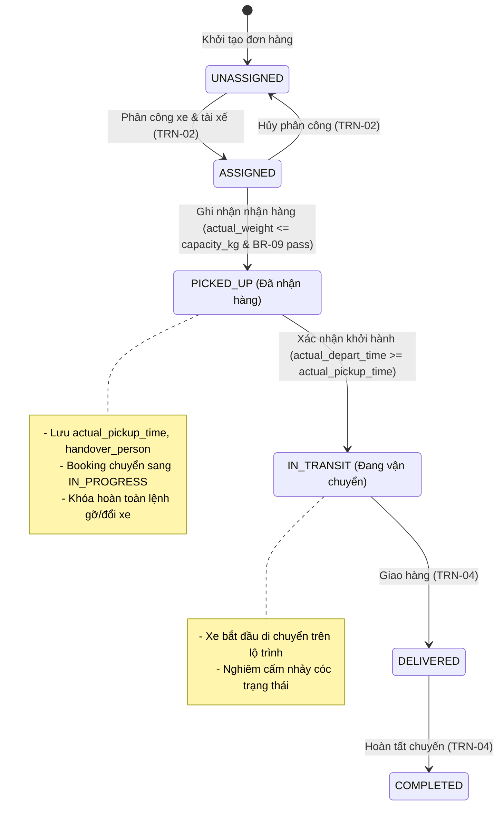

# Data Model Specification: TRN-03 Ghi nhận nhận hàng và vận chuyển

## 1. Cấu trúc Mô hình Thực thể (Entity Relationship & Schemas)

### 1.1. Mở rộng Bảng `trips` (Chuyến Hàng)

Bổ sung các trường dữ liệu theo dõi mốc thực tế của giai đoạn nhận hàng và khởi hành:

| Tên Cột | Kiểu Dữ Liệu | Ràng Buộc (Constraints) | Mô Tả |
| :--- | :--- | :--- | :--- |
| `actual_cargo_weight_kg` | `INTEGER` | `NULLABLE`, `CHECK (actual_cargo_weight_kg > 0)` | Khối lượng hàng thực tế cân tại điểm lấy hàng |
| `handover_person` | `VARCHAR(100)` | `NULLABLE` | Họ tên người bàn giao hàng phía kho gửi |
| `cargo_condition` | `VARCHAR(255)` | `NULLABLE` | Mô tả tình trạng đóng gói, bao bì, niêm phong hàng hóa |
| `discrepancy_notes` | `VARCHAR(500)` | `NULLABLE` | Ghi chú giải trình chênh lệch khối lượng/số lượng (nếu có) |
| `actual_pickup_time` | `DATETIME` | `NULLABLE` | Thời điểm thực tế nhận hàng tại kho |
| `actual_depart_time` | `DATETIME` | `NULLABLE` | Thời điểm thực tế xe lăn bánh rời điểm lấy hàng |
| `pickup_recorded_at` | `DATETIME` | `NULLABLE` | Thời điểm hệ thống ghi nhận mốc nhận hàng |
| `depart_recorded_at` | `DATETIME` | `NULLABLE` | Thời điểm hệ thống ghi nhận mốc khởi hành |

```sql
-- DDL Migration cho SQLite / SQL Server / PostgreSQL
ALTER TABLE trips ADD COLUMN actual_cargo_weight_kg INTEGER NULL CHECK (actual_cargo_weight_kg > 0);
ALTER TABLE trips ADD COLUMN handover_person VARCHAR(100) NULL;
ALTER TABLE trips ADD COLUMN cargo_condition VARCHAR(255) NULL;
ALTER TABLE trips ADD COLUMN discrepancy_notes VARCHAR(500) NULL;
ALTER TABLE trips ADD COLUMN actual_pickup_time DATETIME NULL;
ALTER TABLE trips ADD COLUMN actual_depart_time DATETIME NULL;
ALTER TABLE trips ADD COLUMN pickup_recorded_at DATETIME NULL;
ALTER TABLE trips ADD COLUMN depart_recorded_at DATETIME NULL;
```

---

### 1.2. Bảng Mới `trip_events` (Dòng Thời Gian Lịch Sử & Kiểm Toán)

Lưu vết bất biến toàn bộ các mốc sự kiện phát sinh trong vòng đời của chuyến hàng phục vụ tính năng Timeline và đối soát sau này.

| Tên Cột | Kiểu Dữ Liệu | Ràng Buộc | Mô Tả |
| :--- | :--- | :--- | :--- |
| `id` | `INTEGER` | `PRIMARY KEY`, `AUTOINCREMENT` | Định danh sự kiện |
| `trip_id` | `INTEGER` | `NOT NULL`, `FOREIGN KEY (trips.id)`, `INDEX` | Khóa ngoại trỏ về chuyến hàng |
| `event_type` | `VARCHAR(50)` | `NOT NULL` | Loại sự kiện: `PICKUP_CONFIRMED`, `DEPARTURE_CONFIRMED` |
| `from_status` | `VARCHAR(20)` | `NOT NULL` | Trạng thái trước khi chuyển (`ASSIGNED`, `PICKED_UP`) |
| `to_status` | `VARCHAR(20)` | `NOT NULL` | Trạng thái sau khi chuyển (`PICKED_UP`, `IN_TRANSIT`) |
| `actual_time` | `DATETIME` | `NOT NULL` | Thời điểm thực tế diễn ra sự kiện do tài xế cung cấp |
| `recorded_at` | `DATETIME` | `NOT NULL`, `DEFAULT UTC NOW` | Thời điểm ghi nhận vào cơ sở dữ liệu hệ thống |
| `recorded_by_user_id` | `INTEGER` | `NULLABLE`, `FOREIGN KEY (users.id)` | Người dùng (DSP) thực hiện xác nhận |
| `notes` | `VARCHAR(500)` | `NULLABLE` | Ghi chú hoặc chi tiết bổ sung |

```sql
CREATE TABLE trip_events (
    id INTEGER PRIMARY KEY AUTOINCREMENT,
    trip_id INTEGER NOT NULL REFERENCES trips(id) ON DELETE CASCADE,
    event_type VARCHAR(50) NOT NULL,
    from_status VARCHAR(20) NOT NULL,
    to_status VARCHAR(20) NOT NULL,
    actual_time DATETIME NOT NULL,
    recorded_at DATETIME NOT NULL,
    recorded_by_user_id INTEGER REFERENCES users(id),
    notes VARCHAR(500) NULL
);
CREATE INDEX ix_trip_events_trip_id ON trip_events(trip_id);
```

---

### 1.3. Cập nhật Bảng `resource_bookings` (Lịch Trình Nguồn Lực)

Khi chuyến hàng được xác nhận nhận hàng (`PICKED_UP`), toàn bộ các booking tương ứng của xe và tài xế được cập nhật trạng thái:

```text
ResourceBooking.status: 'CONFIRMED' ──(Khi nhận hàng PICKED_UP)──> 'IN_PROGRESS'
```

---

## 2. Máy Trạng Thái Chi Tiết (Trip State Machine)



---

## 3. Ràng Buộc Nghiệp Vụ Toàn Vẹn (Canonical Integrity Rules)

1. **Ràng buộc Tải trọng Thực tế (BR-06)**:
   $$\text{actual\_cargo\_weight\_kg} \le \text{assigned\_truck.capacity\_kg}$$
   Nếu vi phạm: Hệ thống ném ngoại lệ `BusinessRuleViolationError`, giữ nguyên `status = ASSIGNED`.
2. **Ràng buộc Xung đột Nguồn lực Đang làm việc (BR-09)**:
   Xe tải hoặc tài xế không được có bất kỳ bản ghi `ResourceBooking` nào khác có `status == 'IN_PROGRESS'` tại thời điểm nhận hàng.
3. **Ràng buộc Thời gian Logic**:
   $$\text{actual\_pickup\_time} \le \text{Server Current Time}$$
   $$\text{actual\_depart_time} \ge \text{actual\_pickup\_time}$$
4. **Ràng buộc Bất biến Lịch sử (Immutable Audit Trail)**:
   Dữ liệu trong bảng `trip_events` chỉ được phép `INSERT`, không hỗ trợ `UPDATE` hoặc `DELETE`.
