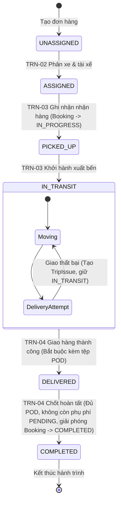
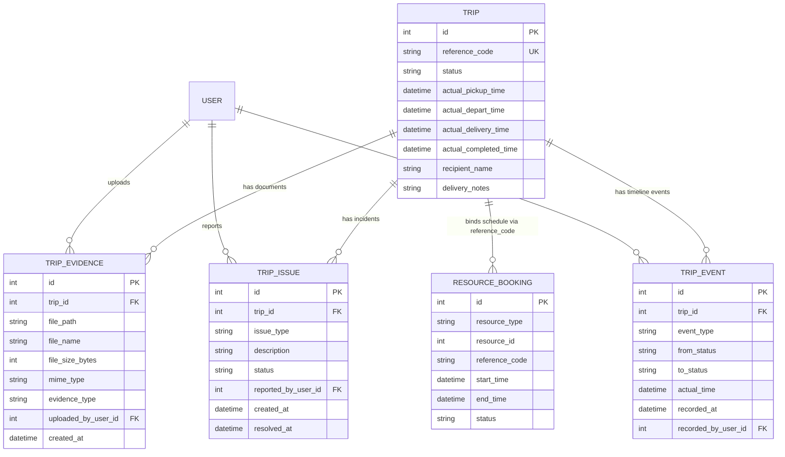

# Data Model Design: TRN-04 Xác nhận giao hàng và hoàn tất

**Branch**: `005-delivery-and-completion` | **Date**: 2026-11-25 | **Feature**: [spec.md](spec.md)

Tài liệu này định nghĩa chi tiết lược đồ dữ liệu, các thực thể, mối quan hệ, ràng buộc chuẩn hóa (canonical constraints) và máy trạng thái (state machine) cho module **TRN-04**.

---

## 1. Biểu Đồ Máy Trạng Thái (State Machine Diagram)



---

## 2. Bảng Chuyển Đổi Trạng Thái (State Transition Table)

| Trạng Thái Ban Đầu (`from_status`) | Hành Động Kích Hoạt | Điều Kiện Tiền Đề & Ràng Buộc Kiểm Tra | Trạng Thái Đích (`to_status`) | Tác Vụ Đi Kèm (Side Effects) |
|---|---|---|---|---|
| `IN_TRANSIT` | Xác nhận Giao Hàng Thành Công | - `actual_delivery_time >= actual_pickup_time`<br>- Có tối thiểu 1 tệp chứng từ POD hợp lệ<br>- `recipient_name` không được để trống | `DELIVERED` | - Lưu tệp vào đĩa và tạo bản ghi `TripEvidence`<br>- Cập nhật `actual_delivery_time`, `recipient_name`, `delivery_notes`<br>- Ghi `TripEvent` (`DELIVERY_CONFIRMED`) |
| `IN_TRANSIT` | Báo cáo Giao Hàng Thất Bại | - Kết quả giao: `FAILED`<br>- Có mô tả lý do giao thất bại | `IN_TRANSIT` *(Giữ nguyên)* | - Tạo bản ghi sự cố `TripIssue` (`OPEN`)<br>- Lưu ảnh chứng cứ sự cố nếu có<br>- Ghi `TripEvent` (`DELIVERY_FAILED`) |
| `DELIVERED` | Chốt Hoàn Tất Chuyến Hàng | - `actual_completed_time >= actual_delivery_time`<br>- `actual_completed_time <= current_time`<br>- Có ít nhất 1 bản ghi `TripEvidence`<br>- Không có phụ phí nào ở trạng thái `PENDING` | `COMPLETED` | - Cập nhật `actual_completed_time`<br>- Đổi trạng thái `ResourceBooking` (Xe & Tài xế) sang `COMPLETED`<br>- Cập nhật `end_time` của booking thành `actual_completed_time`<br>- Giải phóng nguồn lực cho BR-09<br>- Ghi `TripEvent` (`TRIP_COMPLETED`) |
| Khác `IN_TRANSIT` (ví dụ `ASSIGNED`, `PICKED_UP`) | Xác nhận Giao Hàng | Vi phạm quy tắc máy trạng thái | *Bị từ chối (HTTP 400)* | Không có thay đổi dữ liệu |
| Khác `DELIVERED` (ví dụ `IN_TRANSIT`) | Chốt Hoàn Tất | Vi phạm quy tắc máy trạng thái | *Bị từ chối (HTTP 400)* | Không có thay đổi dữ liệu |

---

## 3. Lược Đồ Thực Thể Chi Tiết (Entity Schemas)

### 3.1. Thực thể Mở rộng: `Trip` (Bảng `trips`)

Bổ sung các trường quản lý mốc giao hàng và hoàn tất:

```text
Trip (trips)
├── ... các trường hiện hữu từ TRN-01, TRN-02, TRN-03 ...
├── actual_delivery_time: DATETIME, NULLABLE
│   Ràng buộc: Khi status = 'DELIVERED' hoặc 'COMPLETED', bắt buộc NOT NULL.
│   Kiểm tra: actual_delivery_time >= actual_pickup_time.
├── actual_completed_time: DATETIME, NULLABLE
│   Ràng buộc: Khi status = 'COMPLETED', bắt buộc NOT NULL.
│   Kiểm tra: actual_completed_time >= actual_delivery_time và <= current_time.
├── recipient_name: VARCHAR(100), NULLABLE
│   Ràng buộc: Bắt buộc khi ghi nhận giao hàng thành công.
├── delivery_notes: VARCHAR(500), NULLABLE
│   Ghi chú tình trạng giao nhận hoặc lưu ý tại điểm giao.
├── delivery_recorded_at: DATETIME, NULLABLE
│   Thời điểm hệ thống ghi nhận mốc DELIVERED (UTC).
└── completed_recorded_at: DATETIME, NULLABLE
    Thời điểm hệ thống ghi nhận mốc COMPLETED (UTC).
```

### 3.2. Thực thể Mới: `TripEvidence` (Bảng `trip_evidence`)

Quản lý tệp chứng từ bàn giao hàng hóa (POD), phiếu cân và ảnh chụp hiện trường:

```text
TripEvidence (trip_evidence)
├── id: INTEGER, PRIMARY KEY, AUTOINCREMENT
├── trip_id: INTEGER, NOT NULL, FOREIGN KEY (trips.id) ON DELETE CASCADE, INDEX
├── file_path: VARCHAR(500), NOT NULL
│   Đường dẫn tương đối tới tệp lưu trên máy chủ (ví dụ: uploads/evidence/abc-123.jpg).
├── file_name: VARCHAR(255), NOT NULL
│   Tên tệp gốc khi người dùng tải lên (ví dụ: bien_ban_giao_hang.pdf).
├── file_size_bytes: INTEGER, NOT NULL
│   Kích thước tệp (bytes), tối đa 10,485,760 bytes (10 MB).
├── mime_type: VARCHAR(100), NOT NULL
│   Loại MIME hợp lệ: 'application/pdf', 'image/jpeg', 'image/png'.
├── evidence_type: VARCHAR(50), NOT NULL, DEFAULT 'POD'
│   Giá trị: 'POD' (Biên bản giao hàng), 'WEIGHING_SLIP' (Phiếu cân), 'INCIDENT_PHOTO' (Ảnh sự cố), 'OTHER'
├── notes: VARCHAR(500), NULLABLE
│   Ghi chú mô tả thêm về chứng từ.
├── uploaded_by_user_id: INTEGER, NULLABLE, FOREIGN KEY (users.id)
└── created_at: DATETIME, NOT NULL, DEFAULT UTC NOW
```

### 3.3. Thực thể Mới: `TripIssue` (Bảng `trip_issues`)

Quản lý sự cố phát sinh trong chuyến hàng (giao thất bại, hư hỏng, khiếu nại):

```text
TripIssue (trip_issues)
├── id: INTEGER, PRIMARY KEY, AUTOINCREMENT
├── trip_id: INTEGER, NOT NULL, FOREIGN KEY (trips.id) ON DELETE CASCADE, INDEX
├── issue_type: VARCHAR(50), NOT NULL
│   Giá trị: 'DELIVERY_FAILED', 'CARGO_DAMAGED', 'CUSTOMER_REJECTED', 'ADDRESS_NOT_FOUND', 'TRAFFIC_DELAY', 'OTHER'
├── description: VARCHAR(1000), NOT NULL
│   Mô tả chi tiết diễn biến sự cố và lý do.
├── status: VARCHAR(20), NOT NULL, DEFAULT 'OPEN'
│   Giá trị: 'OPEN', 'RESOLVED', 'CANCELLED'
├── reported_by_user_id: INTEGER, NULLABLE, FOREIGN KEY (users.id)
├── created_at: DATETIME, NOT NULL, DEFAULT UTC NOW
└── resolved_at: DATETIME, NULLABLE
```

### 3.4. Thực thể Mở rộng: `TripEvent` (Bảng `trip_events`)

Bổ sung các loại sự kiện mới vào `TripEventType`:
- `DELIVERY_CONFIRMED`: Khi giao hàng thành công sang `DELIVERED`.
- `DELIVERY_FAILED`: Khi có báo cáo giao hàng không thành công (chuyến giữ `IN_TRANSIT`).
- `TRIP_COMPLETED`: Khi chuyến hàng được chốt hoàn tất và giải phóng tài nguyên.

### 3.5. Thực thể: `ResourceBooking` (Bảng `resource_bookings`)

Đồng bộ trạng thái khi hoàn tất chuyến hàng:
- `status`: Chuyển từ `IN_PROGRESS` sang `COMPLETED`.
- `end_time`: Cập nhật thành `actual_completed_time`.
- Khi `status == 'COMPLETED'`, nguồn lực lập tức thoát khỏi trạng thái chiếm dụng bận theo quy tắc BR-09.

---

## 4. Biểu Đồ Mối Quan Hệ Thực Thể (ERD)



---

## 5. Ràng Buộc Chuẩn Hóa & Quy Tắc Xác Thực (Validation Rules)

1. **Ràng buộc định dạng tệp:**
   - Chỉ chấp nhận Content-Type: `application/pdf`, `image/jpeg`, `image/png`.
   - Phần mở rộng tệp: `.pdf`, `.jpg`, `.jpeg`, `.png`.
   - Dung lượng: $1 \le \text{size} \le 10,485,760$ bytes.
2. **Ràng buộc thời gian logic:**
   - $\text{actual\_pickup\_time} \le \text{actual\_depart\_time} \le \text{actual\_delivery\_time} \le \text{actual\_completed\_time} \le \text{current\_time}$.
3. **Ràng buộc giải phóng tài nguyên:**
   - Khi hoàn tất đơn, cả hai bản ghi booking (Xe và Tài xế) bắt buộc phải được chuyển sang `COMPLETED` đồng bộ trong cùng một transaction.
