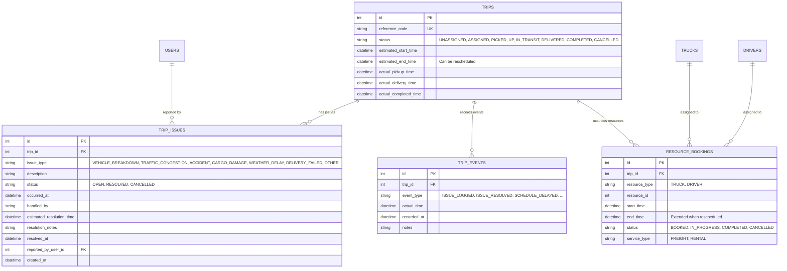
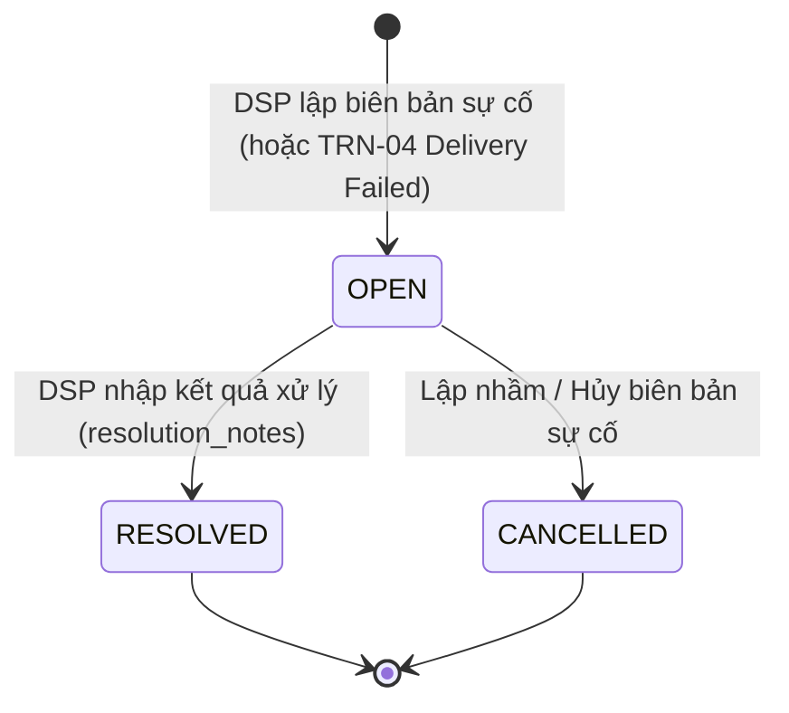
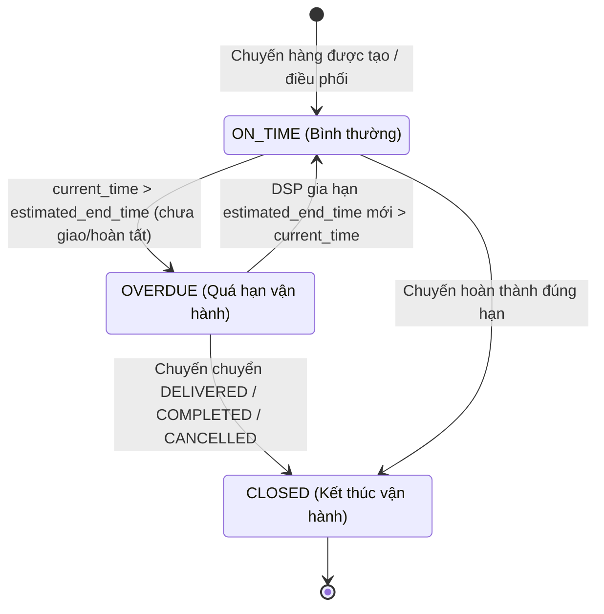

# Data Model: TRN-05 Quản lý sự cố và chậm tiến độ (Incident & Delay Management)

**Feature**: TRN-05 Quản lý sự cố và chậm tiến độ  
**Spec**: [spec.md](spec.md)  
**Date**: 2026-11-25

---

## 1. Sơ Đồ Thực Thể Quan Hệ (Entity-Relationship Diagram)

---

## 2. Chi Tiết Thực Thể & Ràng Buộc Dữ Liệu (Canonical Constraints)

### 2.1. Thực thể `TripIssue` (Nhật ký Sự cố)

Bảng cơ sở dữ liệu: `trip_issues`

| Cột | Kiểu dữ liệu | Ràng buộc | Mô tả & Quy tắc nghiệp vụ |
| :--- | :--- | :--- | :--- |
| `id` | `INTEGER` | `PRIMARY KEY`, `AUTOINCREMENT` | Định danh duy nhất của bản ghi sự cố |
| `trip_id` | `INTEGER` | `FOREIGN KEY (trips.id) ON DELETE CASCADE`, `INDEX`, `NOT NULL` | Tham chiếu chuyến hàng phát sinh sự cố |
| `issue_type` | `VARCHAR(50)` | `NOT NULL` | Phân loại sự cố: `VEHICLE_BREAKDOWN`, `TRAFFIC_CONGESTION`, `ACCIDENT`, `CARGO_DAMAGE`, `WEATHER_DELAY`, `DELIVERY_FAILED`, `OTHER` |
| `description` | `VARCHAR(1000)`| `NOT NULL` | Mô tả chi tiết nguyên nhân, diễn biến và hiện trạng sự cố |
| `status` | `VARCHAR(20)` | `NOT NULL`, `DEFAULT 'OPEN'` | Trạng thái sự cố: `OPEN`, `RESOLVED`, `CANCELLED` |
| `occurred_at` | `DATETIME` | `NOT NULL`, `DEFAULT UTC NOW` | Thời điểm thực tế phát sinh sự cố |
| `handled_by` | `VARCHAR(150)`| `NULLABLE` | Thông tin người/đơn vị phụ trách xử lý (tài xế, cứu hộ, điều phối viên) |
| `estimated_resolution_time` | `DATETIME` | `NULLABLE` | Thời điểm dự kiến khắc phục xong sự cố |
| `resolution_notes`| `VARCHAR(1000)`| `NULLABLE` | Ghi chú kết quả xử lý và giải pháp khắc phục (Bắt buộc khi đổi sang `RESOLVED`) |
| `resolved_at` | `DATETIME` | `NULLABLE` | Thời điểm hoàn tất giải quyết sự cố |
| `reported_by_user_id` | `INTEGER` | `FOREIGN KEY (users.id)`, `NULLABLE` | Người dùng lập biên bản sự cố |
| `created_at` | `DATETIME` | `NOT NULL`, `DEFAULT UTC NOW` | Thời điểm hệ thống ghi nhận bản ghi |

---

### 2.2. Mở rộng Thực thể `Trip`

Model: `src/models/trip.py`

| Thuộc tính | Kiểu dữ liệu | Mô tả & Quy tắc tính toán |
| :--- | :--- | :--- |
| `estimated_end_time` | `DATETIME` | Mốc thời gian kết thúc dự kiến cam kết. Có thể cập nhật lùi mốc thời gian khi xảy ra chậm trễ. |
| `is_delayed` | `@property (bool)` | Trả về `True` nếu `status not in ['DELIVERED', 'COMPLETED', 'CANCELLED']` và `datetime.now() > estimated_end_time`. Ngược lại trả về `False`. |
| `has_open_issues` | `@property (bool)` | Trả về `True` nếu có ít nhất một sự cố liên kết có `status == 'OPEN'`. |
| `issues` | `relationship` | Quan hệ 1-Nhiều liên kết tới các bản ghi `TripIssue`. |

---

### 2.3. Mở rộng `TripEventType`

Enum: `src/models/trip_event.py`

Bổ sung 3 loại sự kiện mới vào `TripEventType`:
1. `ISSUE_LOGGED`: Ghi nhận khi có biên bản sự cố mới được tạo cho chuyến hàng.
2. `ISSUE_RESOLVED`: Ghi nhận khi sự cố được đóng/khắc phục thành công.
3. `SCHEDULE_DELAYED`: Ghi nhận khi điều phối viên điều chỉnh lùi thời gian kết thúc dự kiến do chậm tiến độ.

---

## 3. Máy Trạng Thái (State Machine Diagrams)

### 3.1. Vòng đời Xử lý Sự cố (`TripIssue`)

### 3.2. Chu trình Trạng thái Quá hạn Vận hành (`Operational Delay Lifecycle`)

---

## 4. Quy Tắc Toàn Vẹn & Logic Nghiệp Vụ (Validation Rules)

1. **Ràng buộc Đóng Sự cố**: Khi chuyển `status` sang `RESOLVED`, trường `resolution_notes` KHÔNG ĐƯỢC để trống và `resolved_at` được tự động gán thời điểm hiện tại.
2. **Ràng buộc Gia Hạn Lịch**: Mốc `new_estimated_end_time` bắt buộc phải lớn hơn `estimated_start_time` của chuyến hàng.
3. **Phát hiện Xung đột Lịch Tương lai**:
   - Khi gia hạn lịch, hệ thống truy vấn tất cả `resource_bookings` có `resource_id` trùng với xe hoặc tài xế của chuyến hiện tại, có `trip_id != current_trip_id`, `status in ['BOOKED', 'IN_PROGRESS']`, và có khoảng thời gian `[start_time, end_time]` giao cắt với khoảng gia hạn mới.
   - Nếu có xung đột, hệ thống:
     - Cho phép cập nhật lịch chuyến hiện tại để phản ánh đúng thực tế trễ hạn;
     - Trả về danh sách chi tiết các booking bị ảnh hưởng (Mã chuyến, dịch vụ `FREIGHT` / `RENTAL`, thời gian xung đột);
     - Kích hoạt cảnh báo để điều phối viên chủ động đổi phân công đơn sau.
4. **Bảo vệ Quy tắc BR-09**:
   - Khi chuyến hiện tại bị trễ hạn và vẫn ở trạng thái `IN_PROGRESS` (chưa `COMPLETED`), xe và tài xế tiếp tục bị khóa. Bất kỳ nỗ lực nào nhằm bấm nhận hàng (`PICKED_UP`) cho chuyến kế tiếp đều bị chặn theo đúng quy định BR-09.
5. **Độc lập Doanh thu và Vòng đời**:
   - Việc phát sinh hoặc đóng sự cố không được làm thay đổi trạng thái của chuyến hàng (`Trip.status`), không tự động kết thúc đơn và không tự ý chỉnh sửa giá cước (tuân thủ SAL-08).
